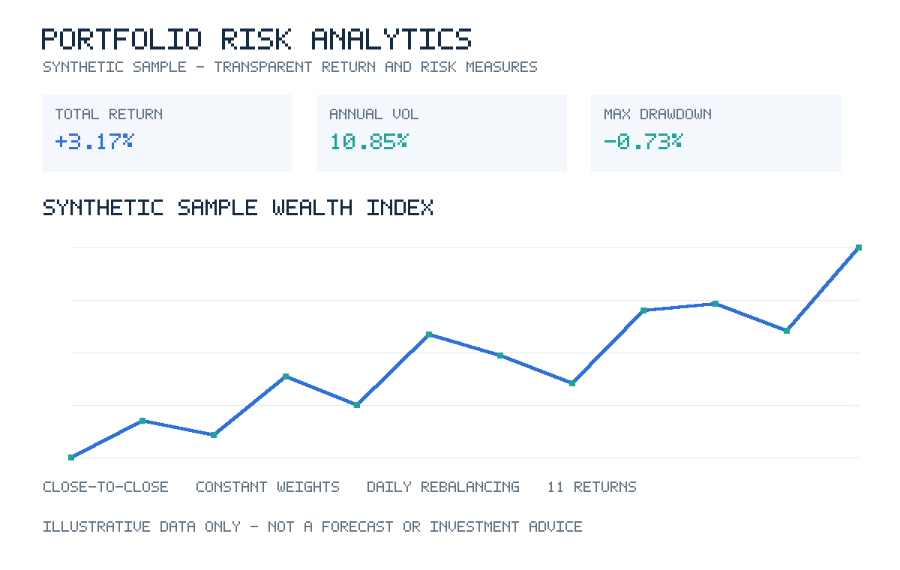
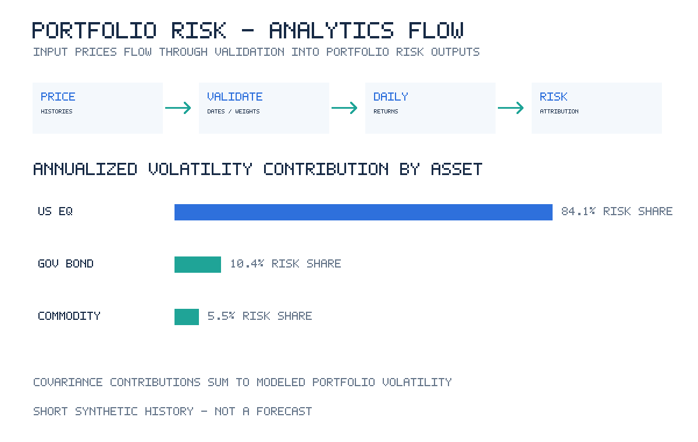

# Portfolio Risk Analytics Platform

A small, dependency-free Python standard-library package that turns aligned
synthetic closing prices into transparent portfolio return and risk metrics.
It is an educational analytics example—not investment advice, a forecast, or
evidence of any real portfolio's performance.

## Run

```sh
PYTHONPATH=src python3 -m portfolio_risk_analytics examples/sample_portfolio.json
PYTHONPATH=src python3 -m unittest discover -s tests -v
```

Write output to a file with `-o results.json`. The input JSON schema is
demonstrated in `examples/sample_portfolio.json`: asset weights must sum to one,
each asset needs at least three strictly ordered, positive-price observations,
and every asset must use the same ISO dates.

## Metrics and assumptions

- Simple close-to-close daily returns.
- Portfolio returns assume constant weights and daily rebalancing.
- Annualized mean return is the arithmetic mean daily portfolio return times
  `periods_per_year`; total return instead compounds the daily returns.
- Volatility and covariance use sample estimates; annualization uses
  `sqrt(periods_per_year)` (252 by default).
- Total return compounds portfolio daily returns; maximum drawdown is measured
  from a starting wealth of 1.0.
- Annualized covariance-based risk contributions are reported in volatility
  units and as shares of modeled portfolio variance. Contributions may be
  negative for hedging positions; this input validator only permits
  long-only weights.

The short sample is synthetic and should not be interpreted as market data or
as a statistically reliable risk estimate.

## Reports

`reports/overview.{svg,png}` summarizes sample wealth and headline metrics.
`reports/flow.{svg,png}` diagrams the calculation stages and charts
covariance-based asset risk contributions. Both are generated from the sample
input with:

```sh
PYTHONPATH=src python3 reports/build_screenshots.py
```

### Project overview



### Calculation flow


